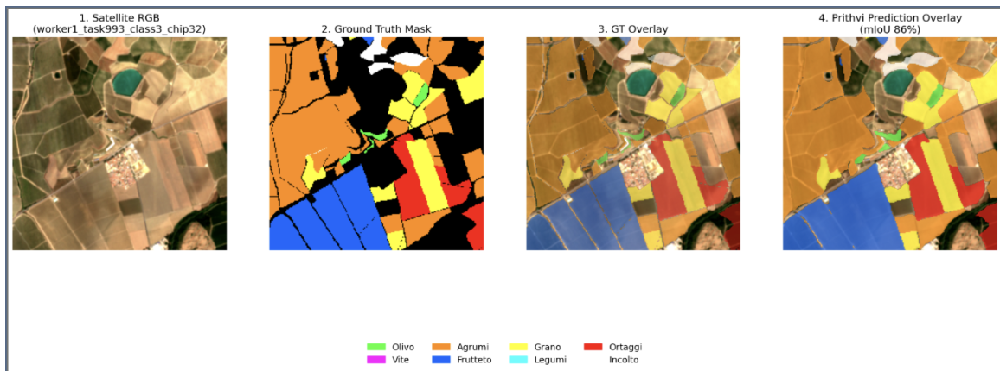

# Crop Segmentation — Sicily & Malta

Semantic segmentation of agricultural crops from **Sentinel-2 L2A** satellite imagery, using a pipeline designed to analyze areas in Sicily and Malta.

The project, presented in the interface as **Smart Food**, combines a **Prithvi EO v2** model, a **FastAPI** API, a **MinIO** cache, and a **Gradio** demo. Given a geographic point or a bounding box, it returns a segmentation overlay, the distribution of crop areas, and NDVI statistics for four seasons.

> The repository contains the inference and service code. Model weights must be provided separately; they are not included in the repository.

## Background and Personal Contribution

This work forms the **satellite semantic segmentation** component of the **Smart Food** project.

My contributions included:

- Identifying and selecting the datasets and agricultural annotations required for the project.
- Developing a distributed **Kafka/Redpanda** pipeline to download and process **Sentinel-2** imagery across multiple nodes.
- **Fine-tuning Prithvi EO v2** to classify pixels into agricultural classes relevant to the Mediterranean region.

The acquisition pipeline is available at [Kafka-distributed-download](https://github.com/DomenicoVillari3/Kafka-distributed-download). This repository contains the inference component, APIs, and demo interface for analyzing areas in Sicily and Malta. The training code and fine-tuned weights are not included in this repository.

## Segmentation Example



From left to right: **RGB satellite image**, **ground truth mask**, **annotation overlay**, and **Prithvi prediction overlay**. The legend maps colors to agricultural classes.

## Features

- Analysis from a point of interest (WGS84 latitude and longitude) or a bounding box.
- Retrieval of satellite data cubes from MinIO and downloading from STAC when data is not cached.
- Multiseason input: four observations and six Sentinel-2 bands.
- Inference on **224 × 224-pixel** chips, with **25%** overlap and confidence-weighted accumulation of predictions in overlapping regions.
- Water filtering based on summer NIR and an optional confidence filter.
- PNG overlays with transparent no-data borders.
- Per-class areas in hectares and percentages.
- Seasonal NDVI with mean, standard deviation, minimum, and maximum.
- Background processing with status polling.
- Web demo with presets for Sicily and Malta.

## Pipeline

1. The API receives coordinates and a year, then returns a `task_id`.
2. `DataResolver` searches for a tile in MinIO; if no usable data is available, it requests a cube from `STACDownloader`.
3. The downloader selects one scene per season from the Earth Search catalog, using the `sentinel-2-l2a` collection, and resamples the bands onto a UTM grid at **10 m/pixel**.
4. `ModelService` normalizes the input and applies the `terratorch_prithvi_eo_v2_100_tl` backbone with the residual decoder defined in `architecture.py`.
5. `InferenceEngine` reconstructs the mask and applies the filters.
6. `postprocess.py` generates overlays, area statistics, and NDVI series.

The cube has shape `(T, C, H, W) = (4, 6, H, W)`. The bands, in the expected order, are:

| Index | Band | STAC Asset | Description |
| ---: | --- | --- | --- |
| 0 | B02 | `blue` | Blue |
| 1 | B03 | `green` | Green |
| 2 | B04 | `red` | Red |
| 3 | B08 | `nir08` | Near infrared |
| 4 | B11 | `swir16` | SWIR 1 |
| 5 | B12 | `swir22` | SWIR 2 |

The actual selection windows are defined in `stac_downloader.py`:

| Season | Window within the Requested Year |
| --- | --- |
| `winter` | January 1 – last day of February |
| `spring` | April 15 – May 30 |
| `summer` | July 1 – August 15 |
| `autumn` | October 1 – November 15 |

The initial cloud cover threshold is **< 20%**, with a fallback to **< 40%**. The analysis requires an available scene for each season; selection uses scene-level cloud cover rather than a per-pixel cloud mask.

## Classes

| ID | Class | Color |
| ---: | --- | --- |
| 0 | Background | `#000000` |
| 1 | Olive | `#32ff32` |
| 2 | Grapevine | `#ff00ff` |
| 3 | Citrus | `#ff8c00` |
| 4 | Orchard | `#0066ff` |
| 5 | Cereals | `#ffff00` |
| 6 | Legumes | `#00ffff` |
| 7 | Vegetables | `#ff0000` |
| 8 | Uncultivated land | `#ffffff` |

Class 0 is excluded from area statistics and NDVI. The `/satellite/classes` endpoint exposes classes 1 through 8.

## Running with Docker

### Prerequisites

- Git, Docker, and Docker Compose.
- An NVIDIA GPU with GPU support configured for Docker: the included Compose file reserves one GPU for the API service.
- Internet access to download images, dependencies, and STAC data. The STAC catalog is also opened during API startup.
- A PyTorch `state_dict` compatible with the project's backbone and decoder.

The API Dockerfile uses `pytorch/pytorch:2.5.1-cuda12.4-cudnn9-runtime`; the demo uses `python:3.11-slim`.

### 1. Clone the Repository and Add the Weights

```bash
git clone https://github.com/DomenicoVillari3/crop-segmentation-Sicily-Malta.git
cd crop-segmentation-Sicily-Malta
mkdir -p weights
```

Copy the compatible checkpoint to `weights/model.pth`. This filename is an example: you can use another name by updating the configuration.

Loading uses `load_state_dict(..., strict=True)` and strips `_orig_mod.` prefixes. The file must directly contain the compatible state dictionary, rather than a checkpoint with a different structure.

### 2. Create the `.env` File

In the project root:

```dotenv
MINIO_ENDPOINT=localhost:9000
MINIO_ACCESS_KEY=smartfood_local
MINIO_SECRET_KEY=replace_with_a_local_password
MINIO_BUCKET_NAME=sentinel-data
MINIO_API_PORT=9000
MINIO_CONSOLE_PORT=9001
MODEL_WEIGHTS_PATH=weights/model.pth
API_BASE_URL=http://localhost:8400
```

Replace the password before starting the services.

Compose automatically sets `MINIO_ENDPOINT=minio:9000` for the API and `API_BASE_URL=http://api:8400` for the demo. For the weights, it prepends `/` to the value of `MODEL_WEIGHTS_PATH`: therefore, use `weights/model.pth`, without a leading slash.

The Dockerfile copies `weights/` to `/weights/`: the directory must exist before the build. If you change the checkpoint, rebuild the API image.

### 3. Start the Services

```bash
docker compose up -d --build
docker compose logs -f api
```

Compose starts four services: `minio`, `createbuckets`, `api`, and `demo`. The `createbuckets` service creates the bucket; wait for it to finish before submitting an analysis.

| Service | Local Address |
| --- | --- |
| Gradio demo | http://localhost:7860 |
| Swagger UI | http://localhost:8400/satellite/docs |
| ReDoc | http://localhost:8400/satellite/redoc |
| API health | http://localhost:8400/satellite/health |
| MinIO console | http://localhost:9001 |

The MinIO ports change if you modify `MINIO_API_PORT` or `MINIO_CONSOLE_PORT`.

To stop the stack:

```bash
docker compose down
```

MinIO data is stored in the local `minio_data/` directory.

## Running the API and Demo Locally

In a Python environment with PyTorch and compatible geospatial dependencies installed:

```bash
python -m pip install -r requirements.txt
uvicorn main:app --host 0.0.0.0 --port 8400
```

The `requirements.txt` file does not include an active PyTorch requirement: make sure PyTorch is already available in the environment. MinIO must be reachable, the bucket must exist, and `.env` must point to the local checkpoint path.

In a second terminal, using the same environment:

```bash
python demo_gui_endpoints.py
```

The model selects CUDA when available and otherwise uses the CPU. To run the Docker stack without a GPU, remove the NVIDIA reservation from the `api` service; inference may take longer on the CPU.

## API

The configured prefix is `/satellite`.

| Method | Path | Result |
| --- | --- | --- |
| POST | `/satellite/point` | Starts a point-based analysis; HTTP 202 and `task_id` |
| POST | `/satellite/bbox` | Starts a bounding-box analysis; HTTP 202 and `task_id` |
| GET | `/satellite/{task_id}/status` | Status, progress, and available results |
| GET | `/satellite/{task_id}/image` | PNG overlay |
| GET | `/satellite/{task_id}/ndvi` | Seasonal NDVI statistics |
| GET | `/satellite/{task_id}/legend` | Legend with hectares and percentages |
| GET | `/satellite/classes` | Static class catalog, excluding background |
| GET | `/satellite/health` | Model diagnostics, device, and MinIO status |

The currently accepted years are **2017–2025**, with **2023** as the default. The current configuration does not include 2026.

### Example: Point Analysis

```bash
curl -X POST http://localhost:8400/satellite/point \
  -H "Content-Type: application/json" \
  -d '{"lat":37.380,"lon":14.910,"year":2023}'
```

The response contains `task_id`, `status: "pending"`, and `progress: 0`; other fields in the response model may be `null`.

Copy the returned value and query the status:

```bash
TASK_ID="insert_the_returned_task_id"
curl "http://localhost:8400/satellite/$TASK_ID/status"
```

The possible statuses are `pending`, `running`, `completed`, and `failed`. Keep polling until the status is `completed`; if it is `failed`, check the `error` field.

Once the analysis is complete:

```bash
curl "http://localhost:8400/satellite/$TASK_ID/image" -o overlay.png
curl "http://localhost:8400/satellite/$TASK_ID/ndvi"
curl "http://localhost:8400/satellite/$TASK_ID/legend"
```

Requests for results before completion return HTTP 202; a nonexistent task returns HTTP 404.

### Example: Bounding Box Analysis

The geographic coordinate order is `[min_lon, min_lat, max_lon, max_lat]`. Both maximum values must be greater than their respective minimum values.

> The BBox path has a known cache lookup issue, described further below. Use the POI endpoint for an initial check of the stack.

```bash
curl -X POST http://localhost:8400/satellite/bbox \
  -H "Content-Type: application/json" \
  -d '{"min_lon":14.395,"min_lat":35.880,"max_lon":14.455,"max_lat":35.940,"year":2023}'
```

The polling and result retrieval procedure is the same as for point analysis.

## Interpreting the Results

- `source`: `minio` if the cube comes from the cache, or `stac` if it was downloaded.
- `year_used`: the year actually used.
- `bbox`: the geographic extent of the resolved cube.
- `class_stats`: areas for the classes present, sorted by hectares in descending order.
- `total_ha`: the sum of classified areas, **excluding background**.
- `percentage`: the proportion of all non-background pixels, rather than of the entire bounding box.
- `ndvi_series`: four seasonal data points, calculated over pixels with a class greater than 0, including the Uncultivated land class.

Areas are calculated assuming **100 m² per pixel**, or **0.01 ha**. NDVI uses `(NIR - Red) / (NIR + Red + 1e-6)`. The overlay combines the summer RGB image and the segmentation, with a default opacity of **55%**.

For POI requests, a cache hit uses a crop of up to **800 × 800 pixels**; the STAC download uses a bounding box centered on the point, measuring **0.1° on each side**. The returned area may therefore differ between a cache hit and the initial download: always check `bbox`.

## Configuration

| Environment Variable | Purpose |
| --- | --- |
| `MINIO_ENDPOINT` | MinIO host and port, without a scheme; the current client uses HTTP |
| `MINIO_ACCESS_KEY` | MinIO credential, required |
| `MINIO_SECRET_KEY` | MinIO credential, required |
| `MINIO_BUCKET_NAME` | Bucket for cubes and previews |
| `MODEL_WEIGHTS_PATH` | Path to the PyTorch state dictionary |
| `API_BASE_URL` | API base URL used by the demo, without `/satellite` |
| `MINIO_API_PORT` | MinIO host port in Compose; default 9000 |
| `MINIO_CONSOLE_PORT` | Console host port in Compose; default 9001 |
| `MIN_CONFIDENCE` | Optional threshold; default 0, filter disabled |

To use `MIN_CONFIDENCE` in the API container, add it to the service's `environment` block: the current Compose file does not pass it through.

The other settings are constants in `config.py`: bands, classes, normalization, overlap, water thresholds, supported years, and the concurrent inference limit, set to **4**. Prediction correction using class priors is enabled through `APPLY_PRIOR_CORRECTION=True`.

## Code Structure

| File | Responsibility |
| --- | --- |
| `main.py` | FastAPI application, tasks, and endpoints |
| `schemas.py` | Pydantic validation and response models |
| `config.py` | Environment variables and pipeline parameters |
| `architecture.py` | Residual decoder and segmentation architecture |
| `model_service.py` | Model loading, normalization, and chip inference |
| `inference_engine.py` | Sliding window, reconstruction, and filters |
| `data_resolver.py` | Data resolution and geographic cropping |
| `stac_downloader.py` | Seasonal selection and Sentinel-2 downloads |
| `minio_store.py` | Cache lookup, download, and upload |
| `postprocess.py` | Overlays, statistics, and NDVI |
| `demo_gui_endpoints.py` | Gradio interface |
| `Dockerfile` / `Dockerfile.demo` | API and demo images |
| `docker-compose.yaml` | Service orchestration |
| `requirements.txt` | Python dependencies |

Cubes are stored in MinIO under `raw_cubes/year=YYYY/`; RGB previews are stored under `rgb_images/year=YYYY/`. Metadata includes the bounding box, year, and cube shape.

## Troubleshooting

| Problem | What to Check |
| --- | --- |
| Missing MinIO credentials | Define `MINIO_ACCESS_KEY` and `MINIO_SECRET_KEY` in the environment or in `.env` |
| Build fails at `COPY weights/` | Create the directory and add the checkpoint before building |
| Weights not found or incompatible | Check the path and the state dictionary's compatibility with the architecture |
| API fails to start with Docker | Check the logs, GPU support, and access to the STAC catalog |
| No data available | Check the coordinates, year, and availability of a scene for each season |
| BBox analysis fails | Check the cache issue described in the limitations |
| Demo times out | Check `/status` and the API logs; try a smaller area |

## License

The repository does not contain a `LICENSE` file. The author must define the terms for reusing the code; check the terms applicable to the model weights and satellite data separately.

## Author

[Domenico Villari](https://github.com/DomenicoVillari3)

Repository: [crop-segmentation-Sicily-Malta](https://github.com/DomenicoVillari3/crop-segmentation-Sicily-Malta)
